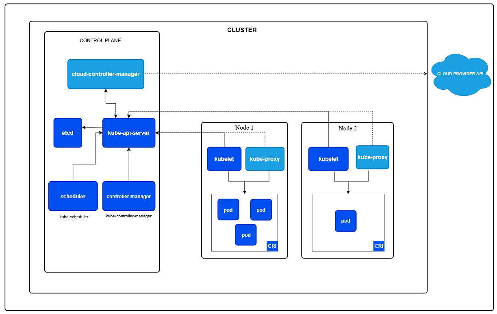

# Kubernetes

### Sumário
- [Descrição](#descrição)
- [Endereços na Web](#endereços-na-web)
- [Arquitetura](#arquitetura)
    - [Control Plane](#control-plane)
    - [Worker Nodes](#worker-nodes)
        - [pods](#pods)

---

### Descrição

O **Kubernetes** é uma plataforma portátil, extensível e de código aberto para gerenciar cargas de trabalho(workloads) e serviços(services) em containeres, facilitando tanto a configuração declarativa quanto a automação.

A palavra kubernetes, tem origem do grego e significa timoneiro.

Uma abreviação muito utilizada para a palavra Kubernetes é **k8s**, o número **8** significa que entre a letra **k** e **s** da palavra kubernetes tem 8 letras.

---

### Endereços na Web

- [Site Kubernetes](https://kubernetes.io/pt-br/)
- [Página do Kubernetes no GitHub ](https://github.com/kubernetes)

---

### Arquitetura

#### Control Plane 

O **Control Plane** gerencia todo o cluster. Ele não roda as suas aplicações diretamente; ele toma as decisões globais, detecta eventos e faz o agendamento. Seus componentes principais incluem:

- **API Server**: O ponto de entrada para todos os comandos (**kubectl**).
- **etcd**: O banco de dados chave-valor distribuído que armazena todo o estado do cluster.
- **Scheduler**: O componente que decide em qual nó um contêiner deve rodar com base em recursos disponíveis.
- **Controller Managers**: Controladores que garantem que o estado atual do cluster seja igual ao estado desejado.

#### Worker Nodes

Os **Worker Nodes** são as máquinas (virtuais ou físicas) onde as suas aplicações de fato rodam. Cada worker node é gerenciado pelo Control Plane e abriga:

- **Kubelet**: O agente principal que roda no nó, garantindo que os containers estejam rodando dentro de um Pod.
- **Kube-proxy**: O componente de rede que gerencia as regras de comunicação e tráfego para os serviços.
- **Runtime de Container**: O motor (como containerd ou **CRI-O**) que executa os containers propriamente ditos.

#### Pods

Um **Pod** é a menor e mais básica unidade de computação que pode-se criar, implantar e gerenciar no Kubernetes.

Para quem vem do Docker, a principal mudança de mentalidade é esta: no Kubernetes, raramente gerencia-se um único container isolado. Gerencia-se Pods, e o Pod é um "casulo" que encapsula um ou mais containers.

---
